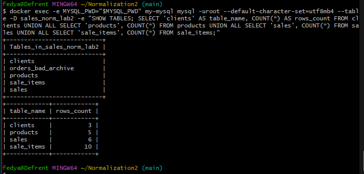
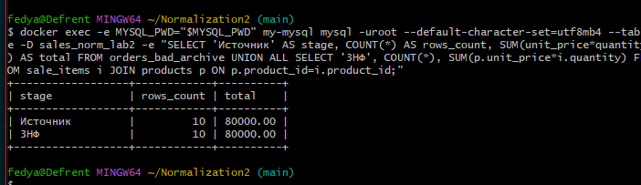
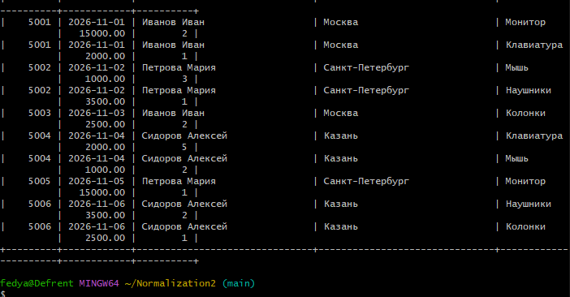
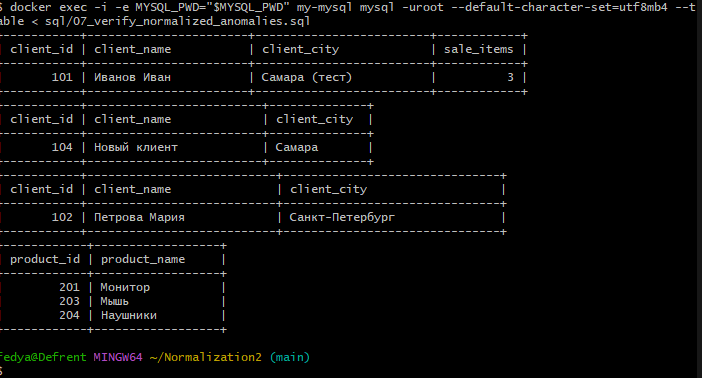
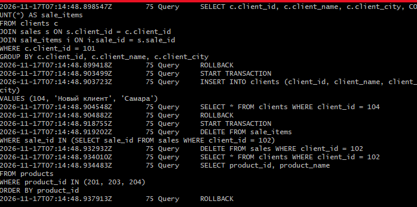

# Лабораторная работа № 2: нормализация данных до 3НФ

Пошаговая работа с MySQL в Docker: аномалии в плоской таблице, разложение на четыре связанные таблицы, перенос данных, проверки, дампы и экспорт журнала SQL-действий.

## 1. Исходные данные и зависимости

В ненормализованной таблице одна строка хранит заголовок продажи, данные клиента, товар и количество. Для исходных десяти записей предполагаемый ключ позиции — `(sale_id, product_id)`.

Функциональные зависимости:

- `sale_id → sale_date, client_id`
- `client_id → client_name, client_city`
- `product_id → product_name, unit_price`
- `(sale_id, product_id) → quantity`

Часть сведений зависит только от части составного ключа — это нарушение 2НФ. Кроме того, имя и город клиента, а также название и цена товара зависят от своих идентификаторов, а не непосредственно от ключа позиции — это транзитивные зависимости, которые устраняются при переходе к 3НФ.

**Уточнение к формулировке задания:** зависимости точнее записывать как `client_id → client_name, client_city` и `product_id → product_name, unit_price`. Выражения `client_name → client_city` и `product_name → unit_price` не следуют из представленных данных.

Аномалии в исходной таблице:

- **Обновление:** имя или город клиента дублируются в каждой его строке продажи; частичное обновление приводит к противоречию.
- **Вставка:** нового клиента нельзя записать отдельно от продажи без пустых или фиктивных данных о продаже и товаре.
- **Удаление:** при удалении последней продажи клиента теряются также сведения о клиенте.

## 2. Итоговая схема

| Таблица | Первичный ключ | Содержимое |
|---|---|---|
| `clients` | `client_id` | Имя и город клиента |
| `products` | `product_id` | Название и цена товара |
| `sales` | `sale_id` | Дата продажи и ссылка на клиента |
| `sale_items` | `(sale_id, product_id)` | Товар и количество в продаже |

Внешние ключи связывают `sales` с `clients`, а `sale_items` — с `sales` и `products`.

## 3. Подготовка Docker и базы

Команды рассчитаны на Git Bash в терминале VS Code и запущенный MySQL-контейнер `my-mysql`. Сначала убедитесь, что контейнер доступен и введите пароль интерактивно — пароль не хранится в репозитории:

```bash
docker ps --filter name=my-mysql
read -s -p "MySQL root password: " MYSQL_PWD
echo
export MYSQL_PWD
```

В MySQL-контейнере уже есть база `sales_norm` с результатами предыдущей лабораторной. Чтобы не перезаписывать и не смешивать прежние данные, эта работа использует отдельную базу **`sales_norm_lab2`**. Исходная таблица при этом называется `orders_bad`; её структура и значения соответствуют заданию. Скрипты ничего не удаляют и создаются для первого запуска.

Убедитесь, что выделенный файл лога ещё не существует:

```bash
docker exec my-mysql sh -c 'test ! -e /var/lib/mysql/normalization2_20261117.log'
```

Перед запуском запишите исходные значения `general_log`, `general_log_file` и `log_output`, чтобы восстановить их после экспорта. В текущем контейнере исходно: `general_log=OFF`, `general_log_file=/var/lib/mysql/ebd28a1e55db.log`, `log_output=FILE`.

Включите журналирование в отдельный файл:

```bash
docker exec -e MYSQL_PWD="$MYSQL_PWD" my-mysql mysql -uroot -e "SET GLOBAL general_log='OFF'; SET GLOBAL general_log_file='/var/lib/mysql/normalization2_20261117.log'; SET GLOBAL log_output='FILE'; SET GLOBAL general_log='ON';"
```

Если тест сообщает, что файл уже есть, остановитесь и выберите новое уникальное имя одновременно в командах настройки и копирования лога. Не перезаписывайте общий или чужой журнал MySQL.

## 4. Создание исходной таблицы и аномалии

Из корневой папки репозитория запустите каждый скрипт один раз:

```bash
docker exec -i -e MYSQL_PWD="$MYSQL_PWD" my-mysql mysql -uroot --default-character-set=utf8mb4 < sql/01_create_bad.sql
docker exec -i -e MYSQL_PWD="$MYSQL_PWD" my-mysql mysql -uroot --default-character-set=utf8mb4 < sql/02_anomalies.sql
```

`01_create_bad.sql` создаёт `sales_norm_lab2.orders_bad` и загружает десять строк. `02_anomalies.sql` демонстрирует частичное изменение города, добавление клиента с пустыми полями продажи и удаление продаж клиента. Каждая пробная операция откатывается транзакцией; исходные десять строк сохраняются.

Снимите дамп до нормализации. На время дампа общий лог выключается, чтобы технические запросы `mysqldump` не попали в журнал действий:

```bash
docker exec -e MYSQL_PWD="$MYSQL_PWD" my-mysql mysql -uroot -e "SET GLOBAL general_log='OFF';"
docker exec -e MYSQL_PWD="$MYSQL_PWD" my-mysql mysqldump -uroot --set-gtid-purged=OFF --single-transaction sales_norm_lab2 orders_bad > dump_before.sql
docker exec -e MYSQL_PWD="$MYSQL_PWD" my-mysql mysql -uroot -e "SET GLOBAL general_log='ON';"
```

Проверьте наличие дампа:

```bash
ls -lh dump_before.sql
```

## 5. Нормализация и проверки

Создайте четыре таблицы и перенесите в них данные через `INSERT ... SELECT`:

```bash
docker exec -i -e MYSQL_PWD="$MYSQL_PWD" my-mysql mysql -uroot --default-character-set=utf8mb4 < sql/03_normalize.sql
```

Сравните суммы, количества записей, значения всех полей и результаты соединения:

```bash
docker exec -i -e MYSQL_PWD="$MYSQL_PWD" my-mysql mysql -uroot --default-character-set=utf8mb4 < sql/04_check.sql
```

Ожидаемые результаты:

- Исходных строк и строк `sale_items`: **10** и **10**.
- Клиентов: **3**; товаров: **5**; продаж: **6**.
- Сумма `SUM(unit_price * quantity)` до и после: **80 000.00**.
- Проверки `missing_from_3nf` и `extra_in_3nf`: **0**.
- Сумма покупок клиента `101`: **37 000.00**.

Отдельно проверьте, что независимые справочники устраняют аномалии:

```bash
docker exec -i -e MYSQL_PWD="$MYSQL_PWD" my-mysql mysql -uroot --default-character-set=utf8mb4 < sql/07_verify_normalized_anomalies.sql
```

Этот скрипт показывает изменение города в одной строке `clients`, вставку клиента без продажи и удаление продаж с сохранением клиента и товара. Каждая проверка откатывается.

Только если проверки прошли, сохраните исходник под архивным именем:

```bash
docker exec -i -e MYSQL_PWD="$MYSQL_PWD" my-mysql mysql -uroot --default-character-set=utf8mb4 < sql/05_archive_source.sql
docker exec -i -e MYSQL_PWD="$MYSQL_PWD" my-mysql mysql -uroot --default-character-set=utf8mb4 < sql/06_verify_archive.sql
```

Исходник не удаляется: он остаётся в `orders_bad_archive` для проверки и аудита.

## 6. Дамп после нормализации

Снова временно выключите журналирование и создайте дамп всей базы:

```bash
docker exec -e MYSQL_PWD="$MYSQL_PWD" my-mysql mysql -uroot -e "SET GLOBAL general_log='OFF';"
docker exec -e MYSQL_PWD="$MYSQL_PWD" my-mysql mysqldump -uroot --set-gtid-purged=OFF --single-transaction --databases sales_norm_lab2 > dump_after.sql
docker exec -e MYSQL_PWD="$MYSQL_PWD" my-mysql mysql -uroot -e "SET GLOBAL general_log='ON';"
ls -lh dump_after.sql
```

`dump_after.sql` содержит четыре таблицы 3НФ и исходные строки в `orders_bad_archive`.

## 7. Экспорт лога действий

Выключите журналирование, скопируйте выделенный файл из контейнера, отфильтруйте SQL-запросы и удалите временную копию:

```bash
docker exec -e MYSQL_PWD="$MYSQL_PWD" my-mysql mysql -uroot -e "SET GLOBAL general_log='OFF';"
docker cp my-mysql:/var/lib/mysql/normalization2_20261117.log ./general_raw.log
python sql/filter_log.py general_raw.log my_actions.log
rm general_raw.log
```

После копирования восстановите исходный путь и состояние журнала (в этом контейнере лог был выключен):

```bash
docker exec -e MYSQL_PWD="$MYSQL_PWD" my-mysql mysql -uroot -e "SET GLOBAL general_log_file='/var/lib/mysql/ebd28a1e55db.log'; SET GLOBAL log_output='FILE'; SET GLOBAL general_log='OFF';"
```

Проверьте результат:

```bash
tail -n 40 my_actions.log
```

Файл `my_actions.log` содержит SQL-команды и их многострочные продолжения из отдельного журнала. Скрипт-фильтр исключает события подключения и служебные настройки логирования.

## 8. Скриншоты для отчёта

Ниже приложены снимки фактического вывода команд. Не вставляйте скриншоты с паролем или временным `general_raw.log`.

Для скриншотов удобно по очереди выполнить:

```bash
docker exec -e MYSQL_PWD="$MYSQL_PWD" my-mysql mysql -uroot --default-character-set=utf8mb4 --table -D sales_norm_lab2 -e "SHOW TABLES; SELECT 'clients' AS table_name, COUNT(*) AS rows_count FROM clients UNION ALL SELECT 'products', COUNT(*) FROM products UNION ALL SELECT 'sales', COUNT(*) FROM sales UNION ALL SELECT 'sale_items', COUNT(*) FROM sale_items;"
docker exec -e MYSQL_PWD="$MYSQL_PWD" my-mysql mysql -uroot --default-character-set=utf8mb4 --table -D sales_norm_lab2 -e "SELECT 'source' AS stage, COUNT(*) AS rows_count, SUM(unit_price*quantity) AS total FROM orders_bad_archive UNION ALL SELECT '3NF', COUNT(*), SUM(p.unit_price*i.quantity) FROM sale_items i JOIN products p ON p.product_id=i.product_id;"
docker exec -e MYSQL_PWD="$MYSQL_PWD" my-mysql mysql -uroot --default-character-set=utf8mb4 --table -D sales_norm_lab2 -e "SELECT s.sale_id, s.sale_date, c.client_name, p.product_name, p.unit_price, i.quantity FROM sales s JOIN clients c ON c.client_id=s.client_id JOIN sale_items i ON i.sale_id=s.sale_id JOIN products p ON p.product_id=i.product_id ORDER BY s.sale_id,p.product_id;"
docker exec -i -e MYSQL_PWD="$MYSQL_PWD" my-mysql mysql -uroot --default-character-set=utf8mb4 --table < sql/07_verify_normalized_anomalies.sql
tail -n 25 my_actions.log
```











## 9. Файлы проекта

- `sql/01_create_bad.sql` — создание и заполнение исходной таблицы.
- `sql/02_anomalies.sql` — три безопасные демонстрации аномалий.
- `sql/03_normalize.sql` — схема 3НФ и перенос данных.
- `sql/04_check.sql` — сравнение данных до архивации источника.
- `sql/05_archive_source.sql` — архивирование исходной таблицы после проверок.
- `sql/06_verify_archive.sql` — финальные проверки после архивации.
- `sql/07_verify_normalized_anomalies.sql` — проверка устранения аномалий в схеме 3НФ.
- `sql/filter_log.py` — экспорт SQL-действий из MySQL general log.
- `dump_before.sql`, `dump_after.sql` — дампы до и после нормализации.
- `my_actions.log` — отфильтрованный журнал действий.
